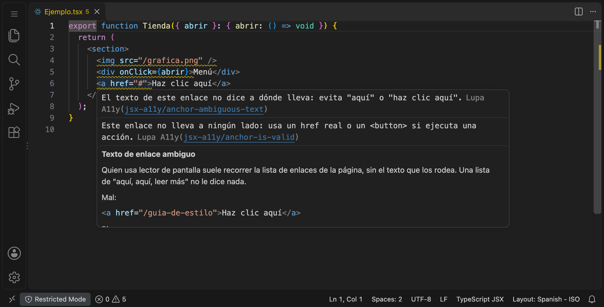
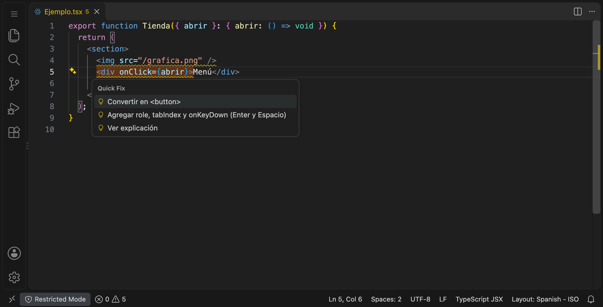
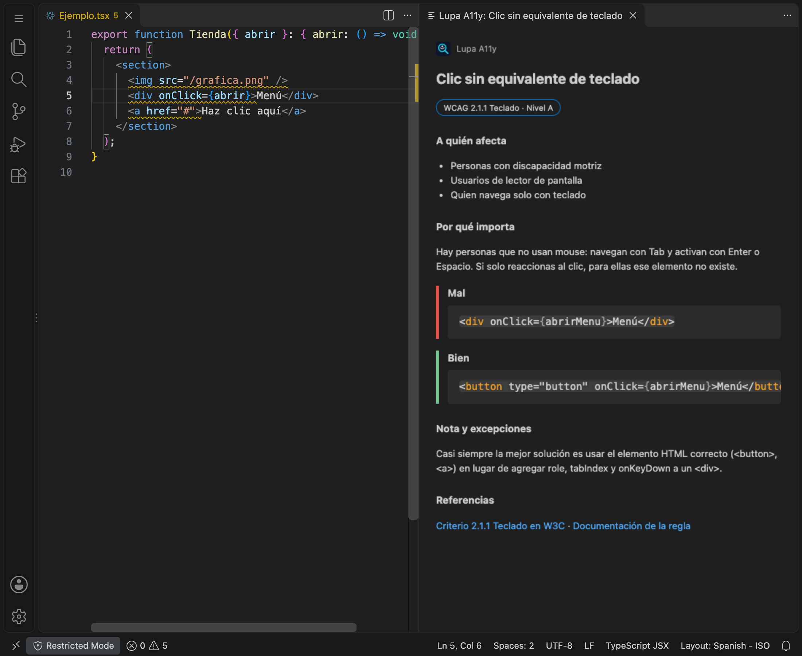

<p align="center">
  <picture>
    <source media="(prefers-color-scheme: dark)" srcset="assets/brand/logo-horizontal-dark.png">
    
  </picture>
</p>

# Lupa A11y

[](https://github.com/AnderCMD/Lupa-a11y/actions/workflows/ci.yml)
[](https://marketplace.visualstudio.com/items?itemName=AnderCMD.lupa-a11y)
[](https://marketplace.visualstudio.com/items?itemName=AnderCMD.lupa-a11y)
[](https://www.npmjs.com/package/lupa-a11y-core)
[](LICENSE)

**Linter de accesibilidad con explicaciones en español para React, Next.js, Vue, Nuxt, Svelte, SvelteKit, Astro, Angular, Solid, Preact, Qwik y HTML.**

Lupa A11y detecta problemas de accesibilidad mientras escribes y no se queda en "esto está mal": te explica **por qué importa**, **a quién afecta**, te muestra un ejemplo **mal vs. bien** y te dice qué criterio de [WCAG 2.2](https://www.w3.org/WAI/WCAG22/Understanding/) toca. Está pensada para quien está aprendiendo.

## Por qué existe

Ya hay linters de accesibilidad muy buenos, pero están en inglés. Lupa A11y no reimplementa reglas: usa como motor [`eslint-plugin-jsx-a11y`](https://github.com/jsx-eslint/eslint-plugin-jsx-a11y), [`eslint-plugin-vuejs-accessibility`](https://github.com/vue-a11y/eslint-plugin-vuejs-accessibility) y [`@html-eslint`](https://html-eslint.org/) y les añade una **capa educativa en español**. El valor está en la calidad de los textos y en la experiencia dentro del editor.

## Frameworks compatibles

| Framework                                  | Archivos                                | Motor                               |
| ------------------------------------------ | --------------------------------------- | ----------------------------------- |
| React, Next.js, Remix, Preact, Solid, Qwik | `.jsx`, `.tsx` y `.js` con JSX          | `eslint-plugin-jsx-a11y`            |
| Vue, Nuxt                                  | `.vue` (incluido `<script lang="ts">`)  | `eslint-plugin-vuejs-accessibility` |
| Svelte, SvelteKit                          | `.svelte`                               | `@html-eslint` (*)                  |
| Astro                                      | `.astro`                                | `@html-eslint` (*)                  |
| Angular                                    | plantillas `.html` (`*.component.html`) | `@html-eslint` (*)                  |
| HTML, Alpine.js, htmx, Eleventy…           | `.html`                                 | `@html-eslint`                      |

(*) Antes de analizar, Lupa A11y normaliza la plantilla sin mover las posiciones: entiende `alt={expr}`, el atajo `{alt}`, bloques `{#if}`, el frontmatter de Astro y los bindings de Angular `[alt]`, `[attr.aria-label]` y `bind-alt`. Las expresiones se tratan como valores dinámicos, así que no se analiza el marcado que haya _dentro_ de una expresión (por ejemplo, el de un `{items.map(...)}` en Astro).

Las reglas equivalentes comparten la misma explicación en español: `vuejs-accessibility/alt-text` y `@html-eslint/require-img-alt` muestran el texto de `jsx-a11y/alt-text`.

## Qué hace

- **Diagnósticos** en el panel Problems y subrayados, con un mensaje corto en español.
- **Hover** con título, motivo, ejemplo mal/bien y enlace al criterio WCAG.
- **"Ver explicación"**: un panel con la explicación completa, legible en tema claro y oscuro.
- **Quick fixes seguros**: nunca inventan contenido que necesita criterio humano (por ejemplo, no escriben descripciones de imágenes). También en Vue, Svelte, Astro y HTML.
- **Barra de estado** con el número de problemas del archivo activo y el origen de las reglas (preset o config del proyecto).
- **Analizar todo el workspace**: lleva al panel Problems los problemas de todos los archivos, no solo de los abiertos.
- **Ignorar una regla** en el workspace desde el propio quick fix.
- **CLI** (`npx lupa-a11y`) con el mismo motor, para CI y hooks de git.
- Respeta tu configuración de ESLint si el proyecto tiene una, y [Workspace Trust](https://code.visualstudio.com/docs/editor/workspace-trust).
- Sin telemetría y sin llamadas de red mientras la usas.

## Capturas

**Hover** con la explicación al pasar el cursor sobre el subrayado:



**Quick fixes** con `Ctrl+.` (o ⌘+. en macOS), incluida la acción "Ver explicación":



**Panel de explicación** completo, con a quién afecta, ejemplos mal y bien y el criterio WCAG:



## Instalación

**Desde el Marketplace** (recomendado): [instalar Lupa A11y en VS Code](https://vscode.dev/redirect?url=vscode:extension/AnderCMD.lupa-a11y), buscar "Lupa A11y" en la vista de extensiones, o:

```bash
code --install-extension AnderCMD.lupa-a11y
```

Página de la extensión: [marketplace.visualstudio.com/items?itemName=AnderCMD.lupa-a11y](https://marketplace.visualstudio.com/items?itemName=AnderCMD.lupa-a11y).

**Desde un `.vsix`**, el de la [última release](https://github.com/AnderCMD/Lupa-a11y/releases/latest) o generado por ti (`npm run package`):

```bash
code --install-extension lupa-a11y-<versión>.vsix
```

Requiere VS Code 1.100 o superior.

## Uso

Abre un archivo compatible (`.jsx`, `.tsx`, `.vue`, `.svelte`, `.astro`, `.html`…). Los problemas aparecen solos. Con el cursor sobre un subrayado:

- **Hover** para el resumen.
- **Ctrl+.** (o ⌘+. en macOS) para los quick fixes, "Ver explicación" e "Ignorar … en este workspace".

Comandos de la paleta:

- **Lupa A11y: Alternar linting de accesibilidad**
- **Lupa A11y: Analizar todo el workspace** (respeta `lupaA11y.languages` y omite `node_modules`, `dist`, `.next`, `.nuxt`, `.svelte-kit`, etc.)
- **Lupa A11y: Limpiar resultados del análisis del workspace**

Para Vue, Svelte y Astro, VS Code necesita reconocer el idioma del archivo (por ejemplo, con las extensiones oficiales Vue - Official, Svelte for VS Code o Astro). Las plantillas de Angular son `.html` y funcionan sin nada más.

## CLI para CI

```bash
npx lupa-a11y src/ --max-warnings 0
```

```text
src/App.tsx
  12:7  Esta imagen necesita un atributo alt que describa su contenido.  jsx-a11y/alt-text

✗ 1 problema en 1 de 48 archivos.
```

Opciones: `--format json`, `--ignore-rule <id>` (repetible), `--max-warnings <n>`, `--project-config` (usa tu `eslint.config.*`) y `--max-file-size <kb>`. Sale con código 1 si hay más problemas que `--max-warnings` y con 2 si hay un error de uso. Viene en el paquete [`lupa-a11y-core`](https://www.npmjs.com/package/lupa-a11y-core); en este repositorio también puedes usar `npm run a11y -- <rutas>`.

## Ajustes

| Ajuste                            | Por defecto | Descripción                                                                                     |
| --------------------------------- | ----------- | ----------------------------------------------------------------------------------------------- |
| `lupaA11y.enable`                 | `true`      | Activa o desactiva la extensión.                                                                |
| `lupaA11y.severity`               | `warning`   | Severidad por defecto: `error`, `warning`, `information` o `hint`.                              |
| `lupaA11y.criticalRulesAsError`   | `false`     | Muestra como Error `alt-text`, `aria-role` y `aria-props`.                                      |
| `lupaA11y.ignoreRules`            | `[]`        | Reglas a ignorar, p. ej. `"jsx-a11y/alt-text"` (ignora también sus equivalentes de Vue y HTML). |
| `lupaA11y.lintOn`                 | `type`      | `type` analiza mientras escribes (con 500 ms de espera); `save` solo al guardar.                |
| `lupaA11y.useProjectEslintConfig` | `true`      | Usa el `eslint.config.*` del proyecto si configura reglas de accesibilidad.                     |
| `lupaA11y.maxFileSizeKb`          | `500`       | Los archivos más grandes se omiten.                                                             |
| `lupaA11y.languages`              | todos       | Idiomas del editor que se analizan; quita `"javascript"` o `"html"` si no los quieres.          |
| `lupaA11y.workspaceMaxFiles`      | `2000`      | Máximo de archivos de "Analizar todo el workspace".                                             |

**Configuración del proyecto.** Si existe `eslint.config.js|mjs|cjs`, el workspace es de confianza y esa configuración activa reglas de accesibilidad para el tipo de archivo (`jsx-a11y/*` para JSX, `vuejs-accessibility/*` para Vue, `@html-eslint/*` para HTML/Svelte/Astro), se usan esas reglas (las demás se ignoran). Si tu config no incluye ningún plugin de accesibilidad para ese tipo de archivo, se usa el preset incluido, para no dejarte sin avisos. En un workspace no confiable no se ejecuta esa configuración —es código— y se usa el preset incluido. Si no se puede cargar, vuelve al preset y avisa una sola vez en el canal de salida "Lupa A11y". Las configuraciones en TypeScript (`eslint.config.ts`) no están soportadas.

## Reglas cubiertas

### JSX/TSX (35)

| Regla                                           | Criterio WCAG 2.2                            | Nivel          |
| ----------------------------------------------- | -------------------------------------------- | -------------- |
| `alt-text`                                      | 1.1.1 Contenido no textual                   | A              |
| `anchor-is-valid`                               | 4.1.2 Nombre, función, valor                 | A              |
| `anchor-has-content`                            | 2.4.4 Propósito de los enlaces               | A              |
| `click-events-have-key-events`                  | 2.1.1 Teclado                                | A              |
| `no-static-element-interactions`                | 4.1.2 Nombre, función, valor                 | A              |
| `interactive-supports-focus`                    | 2.1.1 Teclado                                | A              |
| `label-has-associated-control`                  | 1.3.1 Información y relaciones               | A              |
| `control-has-associated-label`                  | 4.1.2 Nombre, función, valor                 | A              |
| `aria-props`                                    | 4.1.2 Nombre, función, valor                 | A              |
| `aria-role`                                     | 4.1.2 Nombre, función, valor                 | A              |
| `role-has-required-aria-props`                  | 4.1.2 Nombre, función, valor                 | A              |
| `heading-has-content`                           | 2.4.6 Encabezados y etiquetas                | AA             |
| `html-has-lang`                                 | 3.1.1 Idioma de la página                    | A              |
| `img-redundant-alt`                             | 1.1.1 Contenido no textual                   | Buena práctica |
| `no-autofocus`                                  | 2.4.3 Orden del foco                         | Buena práctica |
| `tabindex-no-positive`                          | 2.4.3 Orden del foco                         | A              |
| `media-has-caption`                             | 1.2.2 Subtítulos (grabados)                  | A              |
| `iframe-has-title`                              | 4.1.2 Nombre, función, valor                 | A              |
| `anchor-ambiguous-text`                         | 2.4.4 Propósito de los enlaces               | A              |
| `aria-activedescendant-has-tabindex`            | 2.1.1 Teclado                                | A              |
| `aria-proptypes`                                | 4.1.2 Nombre, función, valor                 | A              |
| `aria-unsupported-elements`                     | 4.1.2 Nombre, función, valor                 | A              |
| `autocomplete-valid`                            | 1.3.5 Identificar el propósito de la entrada | AA             |
| `lang`                                          | 3.1.1 Idioma de la página                    | A              |
| `mouse-events-have-key-events`                  | 2.1.1 Teclado                                | A              |
| `no-access-key`                                 | 2.1.4 Atajos con teclado de caracteres       | Buena práctica |
| `no-aria-hidden-on-focusable`                   | 4.1.2 Nombre, función, valor                 | A              |
| `no-distracting-elements`                       | 2.2.2 Pausar, detener, ocultar               | A              |
| `no-interactive-element-to-noninteractive-role` | 4.1.2 Nombre, función, valor                 | A              |
| `no-noninteractive-element-interactions`        | 4.1.2 Nombre, función, valor                 | A              |
| `no-noninteractive-element-to-interactive-role` | 4.1.2 Nombre, función, valor                 | A              |
| `no-noninteractive-tabindex`                    | 2.4.3 Orden del foco                         | Buena práctica |
| `no-redundant-roles`                            | 4.1.2 Nombre, función, valor                 | Buena práctica |
| `role-supports-aria-props`                      | 4.1.2 Nombre, función, valor                 | A              |
| `scope`                                         | 1.3.1 Información y relaciones               | A              |

Las 4 reglas del plugin sin traducir no están en el preset: tres están obsoletas en el plugin (`accessible-emoji`, `label-has-for`, `no-onchange`) y `prefer-tag-over-role` es opinionada. El resto de reglas del plugin están traducidas.

El preset parte de `recommended` de `eslint-plugin-jsx-a11y` y le añade `control-has-associated-label`, `anchor-ambiguous-text`, `lang` y `no-aria-hidden-on-focusable`, y entiende palabras en español en `img-redundant-alt` y `anchor-ambiguous-text`.

### Vue (22) y HTML, Svelte, Astro, Angular (16)

Todas las reglas vigentes de `eslint-plugin-vuejs-accessibility` y las 16 reglas de accesibilidad de `@html-eslint`. Las que equivalen a una regla de JSX reutilizan su explicación; estas tienen la suya propia:

| Regla                                                                               | Criterio WCAG 2.2                | Nivel |
| ----------------------------------------------------------------------------------- | -------------------------------- | ----- |
| `vuejs-accessibility/form-control-has-label` (y `@html-eslint/require-input-label`) | 3.3.2 Etiquetas o instrucciones  | A     |
| `vuejs-accessibility/no-role-presentation-on-focusable`                             | 4.1.2 Nombre, función, valor     | A     |
| `@html-eslint/no-skip-heading-levels`                                               | 1.3.1 Información y relaciones   | A     |
| `@html-eslint/no-heading-inside-button`                                             | 1.3.1 Información y relaciones   | A     |
| `@html-eslint/no-non-scalable-viewport`                                             | 1.4.4 Cambio de tamaño del texto | AA    |
| `@html-eslint/no-aria-hidden-body`                                                  | 4.1.2 Nombre, función, valor     | A     |
| `@html-eslint/no-abstract-roles`                                                    | 4.1.2 Nombre, función, valor     | A     |
| `@html-eslint/require-title`                                                        | 2.4.2 Página titulada            | A     |

`vuejs-accessibility/label-has-for` se configura como en JSX: basta con anidar el campo **o** usar `for`/`id`. Se omite `no-onchange`, obsoleta.

### Quick fixes

- JSX: `alt-text`, `click-events-have-key-events`, `no-static-element-interactions`, `html-has-lang`, `img-redundant-alt`, `tabindex-no-positive` y `no-autofocus`.
- Vue, Svelte, Astro y HTML: imagen sin alt, `<html>` sin `lang`, `tabindex` positivo y `autofocus`.

## Limitaciones

- **El análisis estático no detecta todo.** Ve el código, no la página renderizada: no sabe si un texto alternativo es bueno, si los subtítulos son correctos ni si un componente propio renderiza HTML accesible.
- **No sustituye probar con un lector de pantalla** ni con el teclado, ni una auditoría de accesibilidad.
- **No calcula contraste de color**: eso requiere renderizar la página.
- `img-redundant-alt` detecta palabras en español ("imagen", "foto", "fotografía"); como el plugin compara por palabras, puede haber falsos positivos con alt no ASCII y palabras que contengan "foto" (p. ej. "fotosíntesis").
- Los archivos con errores de sintaxis se ignoran en silencio hasta que se arreglan.
- En Svelte y Astro, el marcado dentro de expresiones (`{cond && }`) no se analiza. En Svelte se analizan las reglas de HTML, no los avisos `a11y_*` del compilador de Svelte.
- En `.ts` sin JSX no se analiza nada (TypeScript no permite JSX en `.ts`). Los `.js` se analizan con JSX activado; si no lo usas, quita `"javascript"` de `lupaA11y.languages`.
- El motor es ESLint 9 (`eslint-plugin-jsx-a11y` aún no declara compatibilidad con ESLint 10).
- Rendimiento medido solo en Node, no dentro de VS Code: ver [docs/rendimiento.md](docs/rendimiento.md). Por qué no se migró a Rust o Go: [ADR 0001](docs/adr/0001-motor-en-javascript-no-rust-ni-go.md).

## Librería para tus propias herramientas

El núcleo (traducciones, motor, quick fixes y la CLI, sin VS Code) se publica en npm como [`lupa-a11y-core`](https://www.npmjs.com/package/lupa-a11y-core) (`npm install lupa-a11y-core eslint`). Ejemplo de uso en su README.

## Ideas para colaborar

Todavía no cubierto: los avisos `a11y_*` del compilador de Svelte; marcado dentro de expresiones de Svelte/Astro; MDX; contraste de color real; otros editores (la CLI y `lupa-a11y-core` ya sirven de base); otros idiomas (la estructura de `src/i18n/` ya está preparada, sin selector de idioma todavía).

## Contribuir

Las contribuciones son bienvenidas: traducciones nuevas o mejores, quick fixes, correcciones y propuestas (puedes abrir un [issue](https://github.com/AnderCMD/Lupa-a11y/issues/new/choose)). Lee [CONTRIBUTING.md](CONTRIBUTING.md) para preparar el entorno, la plantilla y la guía de estilo, y el [código de conducta](CODE_OF_CONDUCT.md). Identidad visual: [assets/brand/README.md](assets/brand/README.md).

## Agradecimientos

- [`eslint-plugin-jsx-a11y`](https://github.com/jsx-eslint/eslint-plugin-jsx-a11y), [`eslint-plugin-vuejs-accessibility`](https://github.com/vue-a11y/eslint-plugin-vuejs-accessibility), [`@html-eslint`](https://html-eslint.org/) y sus mantenedores: sin su trabajo este proyecto no existiría.
- [W3C WAI](https://www.w3.org/WAI/) y las [Pautas de Accesibilidad para el Contenido Web (WCAG) 2.2](https://www.w3.org/TR/WCAG22/), de donde salen los criterios.
- [Inter](https://rsms.me/inter/) (SIL OFL 1.1), la tipografía del logotipo.

Lupa A11y es un proyecto independiente, sin relación con W3C, Deque, ESLint ni Microsoft.

## Licencia

[MIT](LICENSE)
